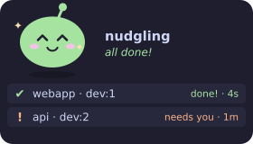
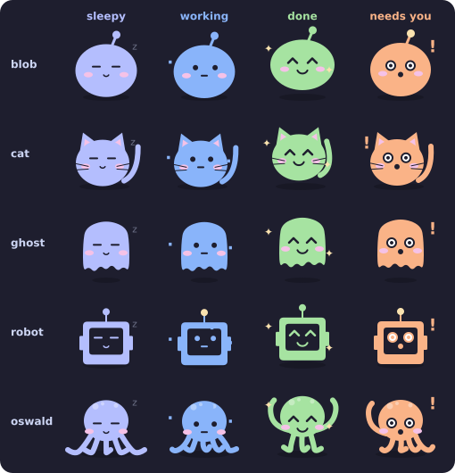

# nudgling 🫧

A tiny desktop pet for Linux that nudges you when **Claude Code** is done, even when Claude runs on another machine you SSH into (in tmux, on a server, wherever).

<p align="center"></p>

Your pet's mood follows your sessions: sleepy when nothing is going on, busy while Claude works, bouncing when Claude finishes, and alarmed when Claude needs your input or permission. "Done" and "needs you" also fire a desktop notification and a sound.

## Pick your pet

<p align="center"></p>

Choose with any of these:

- **right-click** the widget → **Pet**. Your choice is remembered.
- `nudgling --pet oswald`
- `NUDGLING_PET=ghost` in `~/.config/nudgling/config.env`

## How it works

```
 remote box (Claude Code in tmux)            your Linux desktop
 ┌──────────────────────────────┐   HTTP    ┌──────────────────┐
 │ hooks: UserPromptSubmit/Stop/ │ ───────► │ nudgling.py      │
 │        Notification           │ Tailscale│ widget + notify  │
 └──────────────────────────────┘  or LAN   └──────────────────┘
```

Claude Code [hooks](https://docs.claude.com/en/docs/claude-code/hooks) run a small script that POSTs the event to the widget. Sending is fire-and-forget, so if your desktop is off Claude never slows down. Requests need a shared token.

## Install

### 1. On your desktop (where the pet lives)

```bash
# deps: python3 with tkinter, libnotify (notify-send); paplay is optional for sound
sudo pacman -S tk libnotify          # Arch
sudo apt install python3-tk libnotify-bin   # Debian/Ubuntu
sudo dnf install python3-tkinter libnotify  # Fedora

git clone https://github.com/Sreemaee21/nudgling && cd nudgling
install -Dm755 nudgling.py ~/.local/bin/nudgling

mkdir -p ~/.config/nudgling
echo "NUDGLING_TOKEN=$(python3 -c 'import secrets;print(secrets.token_hex(16))')" > ~/.config/nudgling/config.env
chmod 600 ~/.config/nudgling/config.env
cat ~/.config/nudgling/config.env    # copy this token for step 2

nudgling --demo    # watch the pet go through its moods (add --pet cat to try another)
```

Start it at login with systemd:

```bash
install -Dm644 nudgling.service ~/.config/systemd/user/nudgling.service
systemctl --user enable --now nudgling
```

If a firewall is running, allow the port on your tailnet only, for example `sudo ufw allow in on tailscale0 to any port 8765`.

### 2. On the machine running Claude Code

```bash
git clone https://github.com/Sreemaee21/nudgling && cd nudgling
python3 hooks/install-hooks.py \
  --url http://<desktop-tailscale-ip>:8765/event \
  --token <token from step 1>
```

This merges three hooks into your Claude Code `settings.json` (it respects `$CLAUDE_CONFIG_DIR` and backs up the old file). Restart any running Claude sessions to load them.

To test from the remote machine:

```bash
echo '{"session_id":"t","cwd":"/tmp/test"}' | ~/.config/nudgling/nudgling-hook.sh done
```

It works for Claude on the same machine too: use `http://127.0.0.1:8765/event`.

## Controls

- **drag** to move the pet
- **click** a session row to dismiss it
- **right-click** for the menu: switch pet, clear sessions, quit

## Config

Widget (`~/.config/nudgling/config.env` or env vars):

| var | default | |
|---|---|---|
| `NUDGLING_TOKEN` | — | shared secret (required) |
| `NUDGLING_PORT` | `8765` | listen port |
| `NUDGLING_BIND` | `0.0.0.0` | set to your Tailscale IP to listen only there |
| `NUDGLING_SOUND` | `1` | `0` to mute |
| `NUDGLING_PET` | `blob` | `blob`, `cat`, `ghost`, `robot` or `oswald` |

Hook (`~/.config/nudgling/hook.env`): `NUDGLING_URL`, `NUDGLING_TOKEN`.

## Notes

- The widget is a borderless, always-on-top Tk window. That works on X11 and on XWayland. On some pure Wayland compositors it may not stay on top, but notifications still work.
- nudgling is a fan project, not affiliated with Anthropic.

## Regenerating the images

`docs/*.svg` are drawn by the same code as the live widget, and Tk isn't needed:

```bash
python3 nudgling.py --export docs
```

## License

MIT
